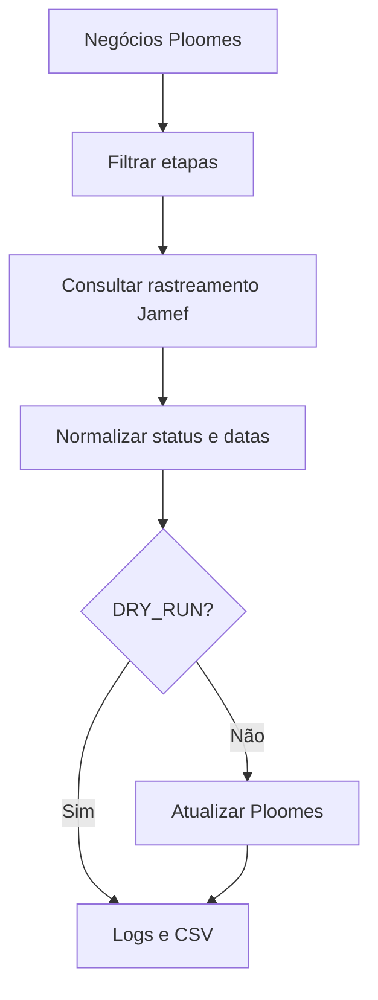

<div align="center">

# 🚚 Jamef → Ploomes Tracking
### Automação de rastreamento e integração de APIs

**Consulta eventos de entrega na Jamef e prepara atualizações de negócios no Ploomes.**

  

</div>

## 🎯 Visão geral

Integração em Python que consulta rastreamentos logísticos, normaliza status e datas e atualiza propriedades de negócios no CRM Ploomes. É um exemplo de **automação empresarial, comunicação entre APIs e rastreabilidade**.

## ✨ Recursos

| Recurso | Objetivo |
|---|---|
| 🔐 API Jamef | Autenticação e consulta de rastreamento |
| 📋 Ploomes | Consulta de negócios por pipeline e etapa |
| 📦 Eventos | Conversão de eventos em descrição e status |
| 📅 Previsões | Extração e cálculo de datas |
| 🧪 DRY_RUN | Simulação sem gravar atualizações |
| 📊 Logs e CSV | Acompanhamento e auditoria |



## 📁 Estrutura

```text
main_jamef.py       # Orquestração
config.py           # Configuração e campos
jamef/              # Cliente da API Jamef
ploomes/            # Cliente da API Ploomes
utils/              # Helpers e tentativas HTTP
logging_config.py   # Logs
text_cleaner.py     # Tratamento de status
requirements.txt    # Dependências
```

## 🚀 Instalação e teste seguro

```bash
git clone https://github.com/WalterMatheusgg/ponte-logistica-jamef-ploomes.git
cd ponte-logistica-jamef-ploomes
python3 -m venv .venv
source .venv/bin/activate
python -m pip install -r requirements.txt
```

Configure suas credenciais e o modo de simulação **explicitamente**:

```bash
export JAMEF_USERNAME="seu_usuario"
export JAMEF_PASSWORD="sua_senha"
export PLOOMES_KEY="sua_chave"
export DRY_RUN="true"
python main_jamef.py
```

Antes de executar, ajuste em `config.py` os valores `PIPELINE_ID`, `STAGE_IDS`, `TAX_ID_REGISTRATION` e `*_FIELD_KEY` para seu ambiente autorizado. O repositório contém marcadores e a lista de etapas está vazia.

**Atenção:** no código atual, se `DRY_RUN` não for definido, o padrão é `false`, que permite gravação. Não execute com credenciais de produção sem validar os filtros e os resultados simulados.

## 🔒 Cuidados e limites

- Não publique chaves de API, dados de clientes nem arquivos de auditoria com informações reais.
- Ajuste a lista de feriados de referência em `config.py`, atualmente referente a 2025.
- Respeite limites das APIs e valide o tratamento de erros.
- A existência do código não significa homologação ponta a ponta.

## 👨‍💻 Autor

**Walter Matheus Soares da Silva** · [GitHub](https://github.com/WalterMatheusgg)
